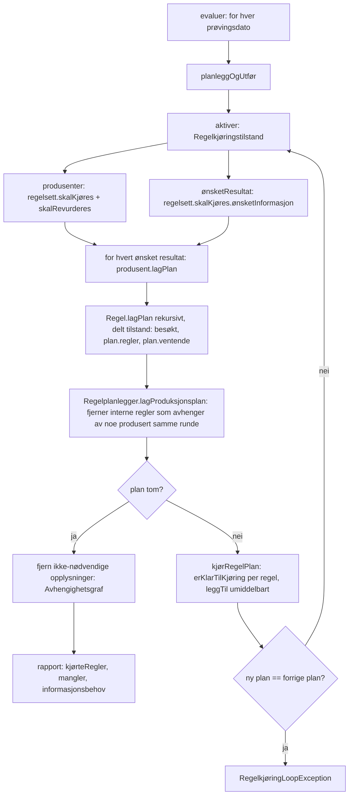
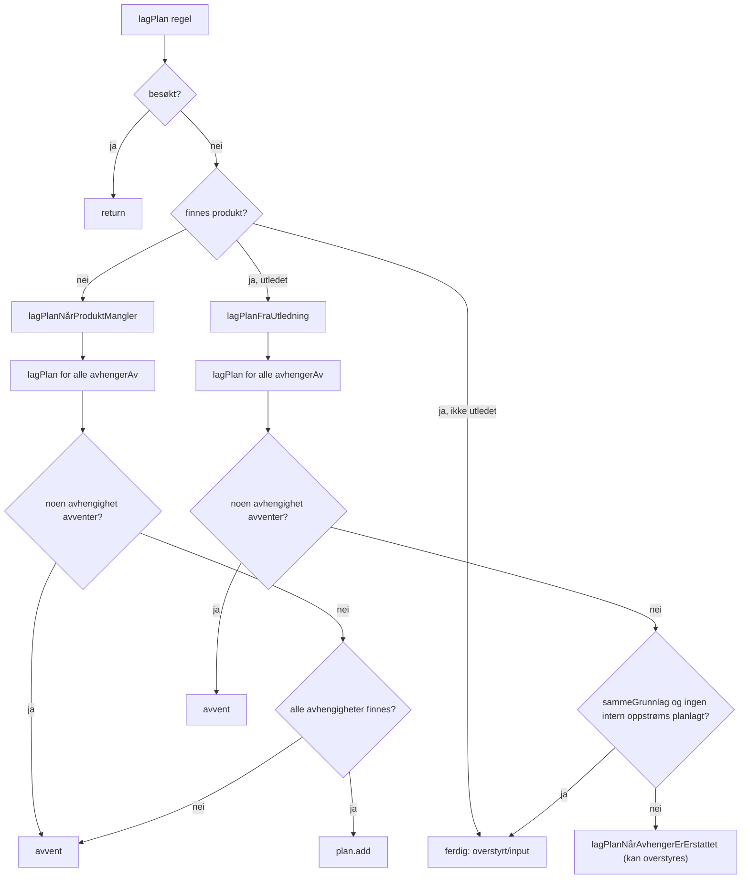
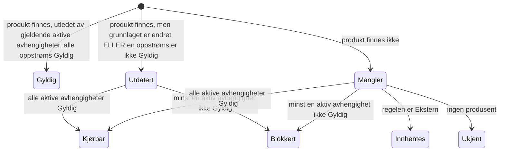

# Regelplanlegging: nåsituasjon, problemer og forslag

Analyse av hvordan `Regel`, `Regelplanlegger` og `Regelkjøring` (modul `opplysninger`) bestemmer hvilke regler som kjøres, og i hvilken rekkefølge.

## 1. Ønsket modell

Grafen leses fra høyre mot venstre. Vi starter med ønsket output og går bakover.

1. Start i `ønsketResultat` (opplysninger vi vil ha).
2. For hver opplysning: finn regelen som produserer den, og se på regelens *aktive* avhengigheter.
3. Gjenta rekursivt til vi treffer noe som kan kjøres (alle avhengigheter finnes og er gyldige), eller noe som må innhentes.
4. Kjør, og planlegg på nytt: nye opplysninger gjør nye regler kjørbare.

Invarianter vi ønsker:

| # | Invariant |
|---|-----------|
| I1 | En regel kjøres kun når alle *aktive* avhengigheter finnes **og** er gyldige (ikke utdaterte, ikke planlagt på nytt). |
| I2 | En regel kjøres aldri i samme runde som en av avhengighetene dens produseres. Den kommer i neste runde. |
| I3 | Utdatert er transitivt: er X utdatert, er alt som er utledet av X utdatert. |
| I4 | `HvisSannMedResultat` har aktive avhengigheter `{sjekk}` og deretter `{sjekk, valgtGren}`. Grenen som ikke velges planlegges, hentes, utledes eller vedlikeholdes aldri. |
| I5 | Opplysninger fra saksbehandler/system (ikke utledet) overstyrer, og planlegges ikke på nytt. |
| I6 | Planlegging er en ren funksjon av `(opplysninger på dato, regelkart, ønsket resultat)`. Ingen skjult tilstand mellom runder. |

## 2. Slik er det i dag

### 2.1 Flyt



### 2.2 Beslutningslogikk i `Regel.lagPlan`



### 2.3 Hvem avgjør hva (spredt ansvar)

| Sted | Ansvar |
|------|--------|
| `Regel.lagPlan` / `lagPlanNårProduktMangler` / `lagPlanFraUtledning` | Rekursjon, ventelogikk, utdatert-sjekk |
| `Regel.lagPlanNårAvhengerErErstattet` | Hook som overstyres av `HvisSannMedResultat` og `Prøvingsdato` |
| `HvisSannMedResultat.lagPlan` | Egen rekursjon, egen `besøkt`-håndtering (`remove` og delegering til super) |
| `TomRegel.lagPlan`, `DagensDato.lagPlan` | Overstyrer hele `lagPlan` |
| `Regelplanlegger.avventer` | `ventende` **eller** (Ekstern og planlagt) |
| `Regelplanlegger.lagProduksjonsplan` | Etterfilter: utsetter regler som avhenger av noe i samme runde (implementerer I2 *etter* at planen er bygget) |
| `Regel.erKlarTilKjøring` | Tredje klarhetssjekk, ved kjøring (HvisSann har egen variant) |
| `Regelkjøring.nyPlan` | Loop-deteksjon som sikkerhetsnett |
| `Avhengighetsgraf` | Eget bakoverkryss for opplysningsopprydding, kjenner ikke til betingethet |
| `GyldighetsperiodeStrategi.arvFraValgtGren` m.fl. | Workaround for at `basertPå` alltid inneholder begge grener |

Klarhet («kan denne kjøres?») avgjøres altså på minst fire steder med litt ulik semantikk: `lagPlanNårProduktMangler`, `lagPlanFraUtledning`, `lagProduksjonsplan` og `erKlarTilKjøring`.

## 3. Funn

### F1. `HvisSannMedResultat` henter begge ben (rotårsak)

Regelen deklarerer `avhengerAv = [sjekk, hvisSann, hvisUsann]`, og alt som bygger på `avhengerAv` behandler begge ben som reelle avhengigheter:

| Sted | Effekt |
|------|--------|
| `Regel.lagPlanFraUtledning` (når produkt finnes) | Planlegger oppstrøms for **begge** ben, og venter (`avventer`) på det ubrukte benet. Dette gir innhenting og beregning av benet som ikke velges. |
| `Regel.lagProdukt` | `basertPå = finnFlere(avhengerAv)` tar med det ubrukte benet hvis det tilfeldigvis finnes. Utledningen forurenses, `Hypotese`/`Faktum` avgjøres av feil ben, og `minsteMulige` gyldighetsperiode påvirkes av feil ben (derfor `arvFraValgtGren`). |
| `sammeGrunnlag`-sjekken | Sammenligner `finnFlere(avhengerAv)` mot lagret utledning. Når det ubrukte benet dukker opp eller forsvinner, regnes produktet som utdatert. Resultatet er unødvendig replanlegging og potensiell loop. |
| `lagProduksjonsplan` | `avhengerAv.none { in produsertDenneRunden }` utsetter regelen pga. ubrukt ben. |
| `Avhengighetsgraf.leggTilAvhengigheter` | Begge ben regnes som nødvendige, så opplysninger i det ubrukte benet blir aldri ryddet bort. Kaster også hvis ben mangler produsent. |
| `Regelkjøringstilstand.informasjonsbehov` | Krever `all { har }` på alle tre. |
| `Regelsett.avhengerAv` | Statisk, begge ben. |

Kun `lagPlanForValgtGren` (brukt når produktet mangler) er betinget, og den dekker bare én av disse stedene.

I tillegg: `lagPlanForValgtGren` bruker `produsenter.finn(...)` som kaster hvis regelsettet er filtrert bort av `skalKjøres`, mens `Regel` ellers bruker `produsenter[x]?.` og tolererer manglende produsent.

### F2. Planleggingstilstanden er delt og mutert under rekursjon

`besøkt` (satt *før* rekursjon), `plan.regler` og `plan.ventende` skrives under DFS-en. Konsekvenser:

* Resultatet av `plan.avventer(x)` avhenger av om `x` er ferdig besøkt. Det er trygt i et rent DAG, men gir stille feilplanlegging hvis det finnes en syklus. En syklus kan ikke oppdages siden `besøkt` bare returnerer.
* `HvisSannMedResultat` gjør `besøkt.remove(this)` og kaller `super.lagPlan`, som legger den til igjen. Dette er et unntak fra invarianten «besøkt = ferdig avgjort».
* «Planlagt» og «kan faktisk kjøres nå» er to forskjellige begreper, men begge bor i `plan.regler`. Regler som skal utsettes ligger i planen frem til `lagProduksjonsplan` filtrerer dem ut. Samtidig leser `internAvhengighetSkalBeregnesPåNytt` `plan.planlegger(...)` for å propagere utdatert-status.

### F3. Utdatert-status er en heuristikk, ikke et begrep

I dag er «utdatert» summen av:

1. `utledetAv != finnFlere(avhengerAv)` (kun direkte nivå),
2. `internAvhengighetSkalBeregnesPåNytt` (om en *direkte* intern oppstrøms regel er planlagt, ikke `KUN_SISTE`, ikke `Ekstern`),
3. `avventer` på noen avhengighet.

Transitivitet (I3) oppnås ved at (2) og (3) tilfeldigvis propagerer gjennom planleggingen i riktig rekkefølge. Unntakene (`Ekstern` og `KUN_SISTE`) er hardkodet midt i logikken. Hvis en oppstrøms regel endrer verdi men beholder samme `id`-sett, oppdages det kun via (2).

### F4. Overstyringene gjør kontrakten uklar

* `TomRegel` og `DagensDato` overstyrer hele `lagPlan` og omgår alle regler (I1, I2, I3 gjelder ikke).
* `DagensDato` planlegger **når** `dagensDato == lagret dato` og ikke når den er ulik. Det ser ut som omvendt av hensikten (utdatert når datoen er endret). Bør verifiseres mot tester.
* `Prøvingsdato.lagPlanNårAvhengerErErstattet` er i praksis et domenespesifikt «gjelder denne kandidaten for dagen?»-predikat, men implementeres som en override midt i planleggingsalgoritmen. Samme loop kan i prinsippet treffe alle regler med `egenVerdi`/`basertPå`-gyldighet (se `PrøvingsdatoLoopTest`, som nå er `@Disabled`).

### F5. Ønsket resultat og regelkart beregnes uavhengig av planen

`produsenter` og `ønsketResultat` evalueres mot opplysningene ved rundestart (`skalKjøres`/`skalRevurderes`). Når en runde endrer opplysninger som regelsettene `skalKjøres` på, får vi først effekt neste runde. Det er greit, men cleanup (`fjernHvis`) gjøres med `Avhengighetsgraf` bygget på *alle* `gjeldendeRegler` (ikke de filtrerte produsentene) og `ønsketResultat` fra siste runde, så to ulike regelkart er i bruk.

### F6. Rekkefølge inne i en runde

Planen er et `Set` (innsettingsrekkefølge). Rekkefølgen er korrekt kun fordi I2 gjør at ingen regel i en runde avhenger av en annen. Dette er riktig, men implementert som etterfilter (F2) i stedet for å følge av klassifiseringen. Reglene som kjøres har derfor ingen innbyrdes avhengighet, og `erKlarTilKjøring` er et forsvar mot tombstones (en tidligere regel i samme runde fjerner indirekte noe).

## 4. Forslag: én enkel klassifisering per regel

Bytt ut «rekursiv DFS med delt mutérbar tilstand» med to rene steg: **1) hva er aktive avhengigheter**, **2) hvilken status har hver regel**, i postorden over aktive avhengigheter.

### 4.1 Nytt begrep: aktive avhengigheter

```kotlin
abstract class Regel<T> {
    val avhengerAv: List<Opplysningstype<*>>          // statisk, for dokumentasjon/regelsett

    // Hva regelen faktisk trenger gitt dagens opplysninger
    open fun aktiveAvhengigheter(opplysninger: LesbarOpplysninger): List<Opplysningstype<*>> = avhengerAv
}

class HvisSannMedResultat {
    override fun aktiveAvhengigheter(o: LesbarOpplysninger) =
        when {
            o.mangler(sjekk) -> listOf(sjekk)
            o.erSann(sjekk) -> listOf(sjekk, hvisSann)
            else -> listOf(sjekk, hvisUsann)
        }
}
```

Alt som i dag leser `avhengerAv` for *dynamisk* logikk bytter til `aktiveAvhengigheter`:

* planlegging (steg under),
* `lagProdukt.basertPå` og dermed `Utledning`, `Hypotese`/`Faktum` og gyldighetsperiode. `arvFraValgtGren` kan da fjernes til fordel for vanlig `minsteMulige`/`arvFra`,
* `Avhengighetsgraf` (cleanup rydder det ubrukte benet),
* `informasjonsbehov`.

`avhengerAv` forblir statisk og brukes kun til dokumentasjon/regeltre og `Regelsett.avhengerAv`.

### 4.2 Statusmodell



| Status | Betydning | I planen? |
|--------|-----------|-----------|
| `Gyldig` | Brukes som den er | nei |
| `Kjørbar` | Mangler eller utdatert, og alle aktive avhengigheter er `Gyldig` | **ja** |
| `Blokkert` | Mangler eller utdatert, men venter på en oppstrøms som er `Kjørbar`, `Blokkert`, `Innhentes` eller `Ukjent` | nei |
| `Innhentes` | `Ekstern` som mangler eller må oppdateres, der avhengigheter er `Gyldig` | som eksternt behov |
| `Ukjent` | Ingen produsent (filtrert av `skalKjøres`) og ingen verdi | nei, rapporteres som `mangler` |

### 4.3 Algoritme

```text
status(regel):                      // memoisert, ren funksjon av opplysninger
  deps = regel.aktiveAvhengigheter(opplysninger)
  depStatus = deps.map { status(produsent(it)) }        // oppstrøms først (postorden)

  produkt = opplysninger[regel.produserer]
  if produkt != null && produkt.utledetAv == null:  return Gyldig       // I5: input/overstyring
  if produkt != null && regel.erOverstyrt(...):      return Gyldig       // domenehook
  oppstrømsOK = depStatus.all { it == Gyldig }

  if produkt != null && oppstrømsOK && sammeGrunnlag(produkt, deps): return Gyldig
  if !oppstrømsOK:                                   return Blokkert     // I1, I2, I3
  return if (regel is Ekstern) Innhentes else Kjørbar
```

Plan = alle regler med status `Kjørbar`, pluss `Innhentes` som eksterne behov. Rekursjonen går kun gjennom `aktiveAvhengigheter` fra ønsket resultat.

Hva dette løser:

| Problem | Hvordan |
|---------|---------|
| F1 | `aktiveAvhengigheter` sørger for at det ubrukte benet aldri besøkes, hentes, regnes inn i utledning eller bevares i cleanup |
| F2 | Ingen `besøkt`/`ventende`/`planlegger`-mutering. Memoisering av status. En syklus kan oppdages eksplisitt (in-progress-markering) og gi en tydelig feil i stedet for stille feilplanlegging |
| F3 | «Utdatert» blir ett predikat: *grunnlaget har endret seg, eller en oppstrøms er ikke `Gyldig`*. Transitivt per konstruksjon (I3) |
| F6 | I2 følger av at `Kjørbar` krever at alle avhengigheter er `Gyldig`. En regel kan aldri avhenge av noe annet i planen. `lagProduksjonsplan`-etterfilteret og `erKlarTilKjøring` blir overflødige (behold som assert) |
| F4 | Domenehooks blir små, navngitte predikater på `Regel` (se under) i stedet for overstyring av planlegging |

### 4.3.1 `Blokkert` bærer årsaken (`venterPå`)

`Blokkert(venterPå: Set<Opplysningstype>)` er mengden aktive avhengigheter som ikke er `Gyldig`. Det gir:

* **Omvendt graf:** `opplysning → regler som venter på den`. Når en regel kjøres, vet vi hvilke regler som kan bli `Kjørbar`, uten å replanlegge alt.
* **Bølger:** regler som blir klare etter en kjøring planlegges i neste bølge, aldri i samme (I2 uten etterfilter).
* **Informasjonsbehov som projeksjon:** `Innhentes`-regler er bladene i ventegrafen. Dagens `informasjonsbehov`-filter blir overflødig.
* **Diagnostikk:** «X venter på Y, som venter på Ekstern Z» kan logges, og er nyttig mot behovsløkker.
* **Betingede grener:** ventemengden til `HvisSannMedResultat` avhenger av verdien til `sjekk` og må ugyldiggjøres når den endrer seg. Ventemengden gjelder per prøvingsdato.

Start med memoisert `status()` per runde. Inkrementell oppdatering mellom runder er en senere optimalisering som må måles først.

**Målt (ScenarioTest):** Av ca. 8 700 evaluerte datoer hadde ca. 8 350 en tom plan (0 runder). Under 400 kjørte 1–25 runder. Et forsøk på å hoppe over planlegging for uendrede datoer ga identiske resultater i alle tester, men ingen målbar tidsgevinst (14,1 s mot 13,5 s, innenfor støy), og ble reversert. Gevinsten ved statusmodellen er derfor diagnostikk og klarere modell, ikke ytelse. Bølgemodellen kutter bare runder på de få datoene som faktisk kjører regler, og endrer rekkefølgen i approved-filene.

### 4.4 Hooks i stedet for override av planleggingen

| Regel | I dag | Foreslått |
|-------|-------|-----------|
| `Ekstern` | Spesialtilfelle i `avventer` og `internAvhengighet...` | Egen status `Innhentes`, ingen unntak i utdatert-logikken |
| `TomRegel` | Overstyrer `lagPlan` til no-op | `Ukjent`/`Innhentes`-lignende, aldri `Kjørbar` |
| `DagensDato` | Overstyrer `lagPlan` | `erUtdatert(produkt) = produkt.verdi != LocalDate.now()` (sjekk først dagens logikk mot tester) |
| `Prøvingsdato` | Override av `lagPlanNårAvhengerErErstattet` | `open fun kanErstatte(produkt, kandidat, dag): Boolean` brukt i `sammeGrunnlag`-steget. Samme domenelogikk, men ikke i algoritmen |
| `HvisSannMedResultat` | Overstyrer `lagPlan`, `lagPlanNårAvhengerErErstattet`, `erKlarTilKjøring` | Kun `aktiveAvhengigheter` og `kjør` |
| `KUN_SISTE`-unntaket | Hardkodet i `lagPlanFraUtledning` | Del av `sammeGrunnlag`-sammenligningen (hvilke ids som sammenlignes) |

### 4.5 Rekkefølge og iterasjon

Én runde: `status` over grafen fra ønsket resultat, kjør alle `Kjørbar`, legg til umiddelbart, bygg ny status. Betingede ben åpnes naturlig: når `sjekk` er produsert, endrer `aktiveAvhengigheter` seg og neste runde krever valgt gren. Runden terminerer når ingen regler er `Kjørbar`. Loop-deteksjonen i `Regelkjøring.nyPlan` beholdes som sikkerhetsnett.

### 4.6 Cleanup bruker samme graf

`Avhengighetsgraf.nødvendigeOpplysninger` bruker `aktiveAvhengigheter(opplysninger)`. Det betyr at opplysninger bare for det ubrukte benet blir ryddet når `sjekk` flipper, og at planlegging og opprydding aldri kan være uenige om hva som er nødvendig.

## 5. Foreslått migrering (små steg, hver for seg grønne)

1. **Test først.** Legg til tester i `HvisSannMedResultatTest` som verifiserer I4: ubrukt ben har en `Ekstern`-produsent som *ikke* skal gi informasjonsbehov, og gyldighetsperioden/`Hypotese` følger valgt ben.
2. **Introduser `aktiveAvhengigheter`** (default `= avhengerAv`) og bruk den i `lagProdukt`, `Avhengighetsgraf` og `informasjonsbehov`. Overstyr i `HvisSannMedResultat`. Dette er den minste endringen som fikser «henter begge ben».
3. **Bruk den i `lagPlanFraUtledning`/`lagPlanNårProduktMangler`** og fjern `HvisSannMedResultat.lagPlan`-overstyringen (inkl. `besøkt.remove`).
4. **Erstatt `besøkt`/`ventende`/`avventer` med memoisert `status()`** (kan gjøres internt i `Regelplanlegger`).
5. **Flytt domenehooks** (`Prøvingsdato`, `DagensDato`, `TomRegel`) til predikater.
6. **Fjern** `lagProduksjonsplan`-etterfilter og `internAvhengighetSkalBeregnesPåNytt`. Behold `erKlarTilKjøring` som assert.
7. Fjern `arvFraValgtGren` når alle bruk (2 stk i `dagpenger`) er over på `minsteMulige`. Aktiver `PrøvingsdatoLoopTest` igjen.

### Status

* Steg 1–3 er gjennomført: `Regel.aktiveAvhengigheter(opplysninger)` brukes i planlegging, `lagProdukt` (utledning), `Regelplanlegger.lagProduksjonsplan`, `Avhengighetsgraf` (evaluert på prøvingsdatoens view) og `informasjonsbehov`. `HvisSannMedResultat` har ikke lenger egne overstyringer av planlegging, bare `aktiveAvhengigheter` og `kjør`.
* Designreview: statusen må beregnes på dato-view (`forDato`), og tombstone-skjult arv må ikke gi falsk `Blokkert`. Dette må på plass før steg 4 (full statusmodell). Syklusdeteksjon (in-progress-markering) skal med i steg 4.
* Statusregistrering er gjennomført: `RegelStatus` (`Gyldig`, `Overstyrt`, `Kjørbar`, `Blokkert(venterPå)`) registreres per regel i `Regelplanlegger` uten å endre oppførsel, og brukes i loop-feilmeldingen. `Avhengighetsgraf.aktivGraf` gir aktiv graf og `lukketSammenlignetMed` for stier som er lukket mellom runder.
* `PrøvingsdatoLoopTest` er aktivert igjen og er grønn.
* Merk: eksisterende lagrede utledninger for `HvisSannMedResultat` inneholder begge ben. Ved omgjøring regnes slike produkter som utdaterte én gang og beregnes på nytt.

### Lærdom fra implementeringen

* **Behovssvar og dato-view:** Svar fra behovsløsere (`Behovsløserkilde`) får gyldighet fra behandlingens start, men en betinget gren kan først åpnes på en senere dato. Cleanup per dato fjernet svaret for tidlig og ga behovsløkke (permitteringspause). Midlertidig løsning: behovssvar ryddes bare på siste dato i prøvingsperioden. Statusmodellen må løse dette riktig: «trengs» må vurderes over hele gyldighetsperioden, ikke bare på én dato.
* **Overstyringer uten `utledetAv`:** Å stoppe `Avhengighetsgraf` ved slike opplysninger brøt to `ScenarioTest`-tester, trolig fordi en overstyring bare dekker deler av perioden og kjeden bak den trengs på andre datoer. I5 (ikke gå forbi overstyring) må derfor gjelde per dato-view.
* **`arvFraValgtGren(sjekk)`:** beholdt, men forenklet til å arve fra den eneste avhengigheten som ikke er `sjekk`. `minsteMulige` ga feil `fraOgMed` (Eksport).
* **`DagensDato`** planlegger nå når lagret dato er ulik i dag (var invertert).
* **`HvisSann.sjekk` uten produsent** blokkerer (som andre regler) og kaster ikke. Låst med test.

### Designreview av statusmodellen (steg 4–6)

Anbefalt rekkefølge:

1. **Invalidering først.** `produsenter` beregnes per runde og avhenger av `skalKjøres`/`skalRevurderes`. Ventemengden må ugyldiggjøres når produsentmengden endres, ikke bare når `sjekk` endrer verdi, ellers kan regler bli permanent `Blokkert`.
2. **Periodebevisst «trengs».** Behovssvar må vurderes over hele gjenstående prøvingsperiode, ikke bare på én dato. Ellers kommer behovsløkka tilbake når den midlertidige løsningen (rydd på siste dato) fjernes.
3. **Datoskopet overstyringsbarriere.** «Ikke se forbi opplysning uten `utledetAv`» gjelder bare når overstyringen er synlig i akkurat den `forDato`-viewen.
4. **`Blokkert(venterPå)` med omvendt graf og bølger**, bygget på 1–3.
5. **Fjern gamle sikkerhetsnett sist.** Behold `erKlarTilKjøring`, `lagProduksjonsplan`-etterfilteret og loop-deteksjonen som asserts til de nye bølgene er bevist likeverdige i tester.

Mest utsatte tester: `FjernHvisGuardTest`, `HvisSannMedResultatTest`, `PrøvingsdatoLoopTest`, `PermitteringTest` (+ approved-filer).

Svakhet i dagens cleanup: `Avhengighetsgraf.nødvendigeOpplysninger` beholder alle typer uten regel globalt (ikke datobevisst). Rettes sammen med steg 3.

## 6. Åpne spørsmål (avklart i 4 av 4: se over)

* Skal `Ukjent` (ingen produsent pga. `skalKjøres=false`) være en feil for `HvisSannMedResultat.sjekk`, slik `produsenter.finn` gjør i dag, eller skal det gi `Blokkert` som for andre regler?
* `DagensDato`: er `isEqual` ment slik, eller skal den planlegge når datoen *ikke* er lik i dag?
* Skal `Regelsett.avhengerAv` (statisk) fortsatt inkludere begge ben i dokumentasjonsgenererte regeltrær? Foreslått: ja, men markert som betinget.
* Skal `produsenter` og `Avhengighetsgraf` bruke samme regelkart (F5)?
