# Regelsett - Dagpenger

Viser hvordan regelsettene avhenger av hverandre.

- `data` (grå): regelsettet bruker opplysninger som et annet regelsett produserer
- `skalVurderes` (rosa): regelsettets `skalVurderes` leser opplysninger fra et annet regelsett
- `påvirkerResultat` (oransje): regelsettets `påvirkerResultat` leser opplysninger fra et annet regelsett
- `kravPåDagpenger`: lesingen skjer via `kravPåDagpenger()`, som igjen leser betingelsene til alle relevante vilkår
- Gul tykk kant: portvakt, et regelsett som minst 5 andre regelsett styres av via `skalVurderes` eller `påvirkerResultat`

Leste opplysninger i `skalVurderes`/`påvirkerResultat` er funnet ved å kjøre lambdaene mot et
opptakende opplysningssett som utforsker alle utfall av hver lesing.

## Graf

```mermaid
graph LR
  classDef Vilkår fill:#1a5fb4,stroke:#0b3d7a,color:#fff
  classDef Fastsettelse fill:#2e7d32,stroke:#1b5e20,color:#fff
  classDef Prosess fill:#b26a00,stroke:#7a4900,color:#fff
  KRAV{{"kravPåDagpenger: alle relevante vilkår"}}
  R0["Alder (Vilkår)"]:::Vilkår
  R1["Meldekortberegning (Fastsettelse)"]:::Fastsettelse
  R2["Dagpengegrunnlag (Fastsettelse)"]:::Fastsettelse
  R3["Sats og barnetillegg (Fastsettelse)"]:::Fastsettelse
  R4["Periode (Fastsettelse)"]:::Fastsettelse
  R5["Egenandel (Fastsettelse)"]:::Fastsettelse
  R6["Eksport til EØS-land (Vilkår)"]:::Vilkår
  R7["Etablering (Vilkår)"]:::Vilkår
  R8["Fulle ytelser (Vilkår)"]:::Vilkår
  R9["Gjenopptak (Vilkår)"]:::Vilkår
  R10["Periode (Vilkår)"]:::Vilkår
  R11["Krav på dagpenger (Vilkår)"]:::Vilkår
  R12["Medlemmets opplysningsplikt (Vilkår)"]:::Vilkår
  R13["Meldeplikt (Vilkår)"]:::Vilkår
  R14["Minsteinntekt (Vilkår)"]:::Vilkår
  R15["Omgjøring uten klage (Prosess)"]:::Prosess
  R16["Skal omgjøring uten klage vurderes? (Prosess)"]:::Prosess
  R17["Opphold (Vilkår)"]:::Vilkår
  R18["Opptjeningsperiode (Fastsettelse)"]:::Fastsettelse
  R19["Permittering (Vilkår)"]:::Vilkår
  R20["Permittering (Fastsettelse)"]:::Fastsettelse
  R21["Permittering fiskeindustri (Vilkår)"]:::Vilkår
  R22["Permittering fiskeindustri (Fastsettelse)"]:::Fastsettelse
  R23["Reell arbeidssøker (Vilkår)"]:::Vilkår
  R24["Registrert som arbeidssøker (Vilkår)"]:::Vilkår
  R25["Rettighetstype (Fastsettelse)"]:::Fastsettelse
  R26["Samordning utenfor folketrygden (Fastsettelse)"]:::Fastsettelse
  R27["Samordning reduserte ytelser (Vilkår)"]:::Vilkår
  R28["Sanksjonsperiode (Vilkår)"]:::Vilkår
  R29["Streik og lock-out (Vilkår)"]:::Vilkår
  R30["Søknad (Vilkår)"]:::Vilkår
  R31["Søknadstidspunkt (Fastsettelse)"]:::Fastsettelse
  R32["Tap av arbeidsinntekt og arbeidstid (Vilkår)"]:::Vilkår
  R33["Tidsbegrenset bortfall (Vilkår)"]:::Vilkår
  R34["Tre meldeperioder uten tilstrekkelig tap (Vilkår)"]:::Vilkår
  R35["Uriktige opplysninger og tilbakeholdelse (Vilkår)"]:::Vilkår
  R36["Utdanning (Vilkår)"]:::Vilkår
  R37["Utestengning (Vilkår)"]:::Vilkår
  R38["Fastsettelse av arbeidstid (Fastsettelse)"]:::Fastsettelse
  R39["Verneplikt (Vilkår)"]:::Vilkår
  R40["Dagpenger ved verneplikt (Fastsettelse)"]:::Fastsettelse
  style R0 stroke:#ffd43b,stroke-width:5px
  style R14 stroke:#ffd43b,stroke-width:5px
  style R25 stroke:#ffd43b,stroke-width:5px
  style R39 stroke:#ffd43b,stroke-width:5px
  R0 -->|data| R31
  R1 -->|data| R4
  R2 -->|data| R31
  R2 -->|data| R18
  R2 -->|data| R25
  R2 -->|data| R40
  R2 -->|skalVurderes| KRAV
  R2 -->|påvirkerResultat| R0
  R3 -->|data| R31
  R3 -->|data| R2
  R3 -->|data| R26
  R3 -->|skalVurderes| KRAV
  R3 -->|påvirkerResultat| KRAV
  R4 -->|data| R31
  R4 -->|data| R14
  R4 -->|data| R2
  R4 -->|skalVurderes| KRAV
  R4 -->|påvirkerResultat| R14
  R4 -->|påvirkerResultat| R39
  R5 -->|data| R31
  R5 -->|data| R3
  R5 -->|data| R25
  R5 -->|skalVurderes| KRAV
  R5 -->|påvirkerResultat| KRAV
  R6 -->|data| R25
  R6 -->|skalVurderes| R25
  R6 -->|påvirkerResultat| R25
  R7 -->|data| R25
  R7 -->|skalVurderes| R25
  R7 -->|påvirkerResultat| R25
  R8 -->|skalVurderes| R14
  R8 -->|skalVurderes| R39
  R8 -->|påvirkerResultat| R14
  R8 -->|påvirkerResultat| R39
  R9 -->|data| R1
  R9 -->|data| R31
  R9 -->|data| R25
  R9 -->|skalVurderes| R25
  R10 -->|skalVurderes| R4
  R13 -->|data| R31
  R13 -->|skalVurderes| R11
  R14 -->|data| R18
  R14 -->|data| R31
  R14 -->|skalVurderes| R0
  R14 -->|påvirkerResultat| R0
  R14 -->|påvirkerResultat| R2
  R15 -->|skalVurderes| R16
  R17 -->|data| R31
  R17 -->|skalVurderes| R14
  R17 -->|skalVurderes| R39
  R17 -->|påvirkerResultat| R14
  R17 -->|påvirkerResultat| R39
  R18 -->|data| R31
  R18 -->|skalVurderes| R0
  R19 -->|data| R25
  R19 -->|data| R20
  R19 -->|skalVurderes| R0
  R19 -->|skalVurderes| R25
  R19 -->|påvirkerResultat| R25
  R20 -->|skalVurderes| R25
  R20 -->|påvirkerResultat| R19
  R21 -->|data| R31
  R21 -->|data| R25
  R21 -->|skalVurderes| R14
  R21 -->|skalVurderes| R39
  R21 -->|skalVurderes| R25
  R21 -->|påvirkerResultat| R14
  R21 -->|påvirkerResultat| R39
  R21 -->|påvirkerResultat| R25
  R22 -->|data| R31
  R22 -->|skalVurderes| R21
  R22 -->|påvirkerResultat| R21
  R23 -->|data| R31
  R23 -->|skalVurderes| R0
  R23 -->|skalVurderes| R25
  R23 -->|påvirkerResultat| R25
  R23 -->|påvirkerResultat| R14
  R23 -->|påvirkerResultat| R39
  R23 -->|påvirkerResultat| R0
  R24 -->|data| R31
  R24 -->|skalVurderes| R0
  R24 -->|påvirkerResultat| R0
  R24 -->|påvirkerResultat| R25
  R25 -->|data| R31
  R25 -->|data| R39
  R25 -->|skalVurderes| R0
  R26 -->|data| R31
  R26 -->|data| R2
  R26 -->|data| R27
  R26 -->|data| R3
  R26 -->|skalVurderes| KRAV
  R26 -->|påvirkerResultat| R14
  R26 -->|påvirkerResultat| R39
  R27 -->|data| R31
  R27 -->|data| R32
  R27 -->|data| R3
  R27 -->|skalVurderes| R14
  R27 -->|skalVurderes| R39
  R28 -->|data| R31
  R28 -->|data| R4
  R28 -->|skalVurderes| KRAV
  R29 -->|skalVurderes| R14
  R29 -->|skalVurderes| R39
  R29 -->|påvirkerResultat| R14
  R29 -->|påvirkerResultat| R39
  R30 -->|data| R31
  R32 -->|data| R31
  R32 -->|data| R25
  R32 -->|data| R20
  R32 -->|data| R21
  R32 -->|data| R2
  R32 -->|data| R40
  R32 -->|data| R38
  R32 -->|skalVurderes| R14
  R32 -->|skalVurderes| R39
  R33 -->|data| R4
  R33 -->|skalVurderes| KRAV
  R34 -->|data| R31
  R34 -->|skalVurderes| R1
  R34 -->|skalVurderes| R9
  R36 -->|data| R31
  R36 -->|skalVurderes| R14
  R36 -->|skalVurderes| R39
  R36 -->|påvirkerResultat| R14
  R36 -->|påvirkerResultat| R39
  R37 -->|data| R31
  R37 -->|skalVurderes| R14
  R37 -->|skalVurderes| R39
  R37 -->|påvirkerResultat| R14
  R37 -->|påvirkerResultat| R39
  R38 -->|data| R32
  R38 -->|data| R27
  R38 -->|data| R23
  R38 -->|skalVurderes| KRAV
  R38 -->|påvirkerResultat| R14
  R38 -->|påvirkerResultat| R39
  R39 -->|data| R31
  R39 -->|skalVurderes| R0
  R39 -->|påvirkerResultat| R25
  R39 -->|påvirkerResultat| R2
  R39 -->|påvirkerResultat| R14
  R40 -->|data| R31
  R40 -->|data| R2
  R40 -->|skalVurderes| R25
  R40 -->|påvirkerResultat| R39
  R40 -->|påvirkerResultat| R2
  linkStyle 0 stroke:#888888
  linkStyle 1 stroke:#888888
  linkStyle 2 stroke:#888888
  linkStyle 3 stroke:#888888
  linkStyle 4 stroke:#888888
  linkStyle 5 stroke:#888888
  linkStyle 6 stroke:#d6336c
  linkStyle 7 stroke:#f08c00
  linkStyle 8 stroke:#888888
  linkStyle 9 stroke:#888888
  linkStyle 10 stroke:#888888
  linkStyle 11 stroke:#d6336c
  linkStyle 12 stroke:#f08c00
  linkStyle 13 stroke:#888888
  linkStyle 14 stroke:#888888
  linkStyle 15 stroke:#888888
  linkStyle 16 stroke:#d6336c
  linkStyle 17 stroke:#f08c00
  linkStyle 18 stroke:#f08c00
  linkStyle 19 stroke:#888888
  linkStyle 20 stroke:#888888
  linkStyle 21 stroke:#888888
  linkStyle 22 stroke:#d6336c
  linkStyle 23 stroke:#f08c00
  linkStyle 24 stroke:#888888
  linkStyle 25 stroke:#d6336c
  linkStyle 26 stroke:#f08c00
  linkStyle 27 stroke:#888888
  linkStyle 28 stroke:#d6336c
  linkStyle 29 stroke:#f08c00
  linkStyle 30 stroke:#d6336c
  linkStyle 31 stroke:#d6336c
  linkStyle 32 stroke:#f08c00
  linkStyle 33 stroke:#f08c00
  linkStyle 34 stroke:#888888
  linkStyle 35 stroke:#888888
  linkStyle 36 stroke:#888888
  linkStyle 37 stroke:#d6336c
  linkStyle 38 stroke:#d6336c
  linkStyle 39 stroke:#888888
  linkStyle 40 stroke:#d6336c
  linkStyle 41 stroke:#888888
  linkStyle 42 stroke:#888888
  linkStyle 43 stroke:#d6336c
  linkStyle 44 stroke:#f08c00
  linkStyle 45 stroke:#f08c00
  linkStyle 46 stroke:#d6336c
  linkStyle 47 stroke:#888888
  linkStyle 48 stroke:#d6336c
  linkStyle 49 stroke:#d6336c
  linkStyle 50 stroke:#f08c00
  linkStyle 51 stroke:#f08c00
  linkStyle 52 stroke:#888888
  linkStyle 53 stroke:#d6336c
  linkStyle 54 stroke:#888888
  linkStyle 55 stroke:#888888
  linkStyle 56 stroke:#d6336c
  linkStyle 57 stroke:#d6336c
  linkStyle 58 stroke:#f08c00
  linkStyle 59 stroke:#d6336c
  linkStyle 60 stroke:#f08c00
  linkStyle 61 stroke:#888888
  linkStyle 62 stroke:#888888
  linkStyle 63 stroke:#d6336c
  linkStyle 64 stroke:#d6336c
  linkStyle 65 stroke:#d6336c
  linkStyle 66 stroke:#f08c00
  linkStyle 67 stroke:#f08c00
  linkStyle 68 stroke:#f08c00
  linkStyle 69 stroke:#888888
  linkStyle 70 stroke:#d6336c
  linkStyle 71 stroke:#f08c00
  linkStyle 72 stroke:#888888
  linkStyle 73 stroke:#d6336c
  linkStyle 74 stroke:#d6336c
  linkStyle 75 stroke:#f08c00
  linkStyle 76 stroke:#f08c00
  linkStyle 77 stroke:#f08c00
  linkStyle 78 stroke:#f08c00
  linkStyle 79 stroke:#888888
  linkStyle 80 stroke:#d6336c
  linkStyle 81 stroke:#f08c00
  linkStyle 82 stroke:#f08c00
  linkStyle 83 stroke:#888888
  linkStyle 84 stroke:#888888
  linkStyle 85 stroke:#d6336c
  linkStyle 86 stroke:#888888
  linkStyle 87 stroke:#888888
  linkStyle 88 stroke:#888888
  linkStyle 89 stroke:#888888
  linkStyle 90 stroke:#d6336c
  linkStyle 91 stroke:#f08c00
  linkStyle 92 stroke:#f08c00
  linkStyle 93 stroke:#888888
  linkStyle 94 stroke:#888888
  linkStyle 95 stroke:#888888
  linkStyle 96 stroke:#d6336c
  linkStyle 97 stroke:#d6336c
  linkStyle 98 stroke:#888888
  linkStyle 99 stroke:#888888
  linkStyle 100 stroke:#d6336c
  linkStyle 101 stroke:#d6336c
  linkStyle 102 stroke:#d6336c
  linkStyle 103 stroke:#f08c00
  linkStyle 104 stroke:#f08c00
  linkStyle 105 stroke:#888888
  linkStyle 106 stroke:#888888
  linkStyle 107 stroke:#888888
  linkStyle 108 stroke:#888888
  linkStyle 109 stroke:#888888
  linkStyle 110 stroke:#888888
  linkStyle 111 stroke:#888888
  linkStyle 112 stroke:#888888
  linkStyle 113 stroke:#d6336c
  linkStyle 114 stroke:#d6336c
  linkStyle 115 stroke:#888888
  linkStyle 116 stroke:#d6336c
  linkStyle 117 stroke:#888888
  linkStyle 118 stroke:#d6336c
  linkStyle 119 stroke:#d6336c
  linkStyle 120 stroke:#888888
  linkStyle 121 stroke:#d6336c
  linkStyle 122 stroke:#d6336c
  linkStyle 123 stroke:#f08c00
  linkStyle 124 stroke:#f08c00
  linkStyle 125 stroke:#888888
  linkStyle 126 stroke:#d6336c
  linkStyle 127 stroke:#d6336c
  linkStyle 128 stroke:#f08c00
  linkStyle 129 stroke:#f08c00
  linkStyle 130 stroke:#888888
  linkStyle 131 stroke:#888888
  linkStyle 132 stroke:#888888
  linkStyle 133 stroke:#d6336c
  linkStyle 134 stroke:#f08c00
  linkStyle 135 stroke:#f08c00
  linkStyle 136 stroke:#888888
  linkStyle 137 stroke:#d6336c
  linkStyle 138 stroke:#f08c00
  linkStyle 139 stroke:#f08c00
  linkStyle 140 stroke:#f08c00
  linkStyle 141 stroke:#888888
  linkStyle 142 stroke:#888888
  linkStyle 143 stroke:#d6336c
  linkStyle 144 stroke:#f08c00
  linkStyle 145 stroke:#f08c00
```

## Tabell

| Regelsett | Data fra | skalVurderes avhenger av | påvirkerResultat avhenger av |
| --- | --- | --- | --- |
| Alder (Vilkår) | Søknadstidspunkt (Fastsettelse) | - | - |
| Meldekortberegning (Fastsettelse) | Periode (Fastsettelse) | - | - |
| Dagpengegrunnlag (Fastsettelse) | Dagpenger ved verneplikt (Fastsettelse), Opptjeningsperiode (Fastsettelse), Rettighetstype (Fastsettelse), Søknadstidspunkt (Fastsettelse) | kravPåDagpenger | Alder (Vilkår) |
| Sats og barnetillegg (Fastsettelse) | Dagpengegrunnlag (Fastsettelse), Samordning utenfor folketrygden (Fastsettelse), Søknadstidspunkt (Fastsettelse) | kravPåDagpenger | kravPåDagpenger |
| Periode (Fastsettelse) | Dagpengegrunnlag (Fastsettelse), Minsteinntekt (Vilkår), Søknadstidspunkt (Fastsettelse) | kravPåDagpenger | Minsteinntekt (Vilkår), Verneplikt (Vilkår) |
| Egenandel (Fastsettelse) | Rettighetstype (Fastsettelse), Sats og barnetillegg (Fastsettelse), Søknadstidspunkt (Fastsettelse) | kravPåDagpenger | kravPåDagpenger |
| Eksport til EØS-land (Vilkår) | Rettighetstype (Fastsettelse) | Rettighetstype (Fastsettelse) | Rettighetstype (Fastsettelse) |
| Etablering (Vilkår) | Rettighetstype (Fastsettelse) | Rettighetstype (Fastsettelse) | Rettighetstype (Fastsettelse) |
| Fulle ytelser (Vilkår) | - | Minsteinntekt (Vilkår), Verneplikt (Vilkår) | Minsteinntekt (Vilkår), Verneplikt (Vilkår) |
| Gjenopptak (Vilkår) | Meldekortberegning (Fastsettelse), Rettighetstype (Fastsettelse), Søknadstidspunkt (Fastsettelse) | Rettighetstype (Fastsettelse) | - |
| Periode (Vilkår) | - | Periode (Fastsettelse) | - |
| Krav på dagpenger (Vilkår) | - | - | - |
| Medlemmets opplysningsplikt (Vilkår) | - | - | - |
| Meldeplikt (Vilkår) | Søknadstidspunkt (Fastsettelse) | Krav på dagpenger (Vilkår) | - |
| Minsteinntekt (Vilkår) | Opptjeningsperiode (Fastsettelse), Søknadstidspunkt (Fastsettelse) | Alder (Vilkår) | Alder (Vilkår), Dagpengegrunnlag (Fastsettelse) |
| Omgjøring uten klage (Prosess) | - | Skal omgjøring uten klage vurderes? (Prosess) | - |
| Skal omgjøring uten klage vurderes? (Prosess) | - | - | - |
| Opphold (Vilkår) | Søknadstidspunkt (Fastsettelse) | Minsteinntekt (Vilkår), Verneplikt (Vilkår) | Minsteinntekt (Vilkår), Verneplikt (Vilkår) |
| Opptjeningsperiode (Fastsettelse) | Søknadstidspunkt (Fastsettelse) | Alder (Vilkår) | - |
| Permittering (Vilkår) | Permittering (Fastsettelse), Rettighetstype (Fastsettelse) | Alder (Vilkår), Rettighetstype (Fastsettelse) | Rettighetstype (Fastsettelse) |
| Permittering (Fastsettelse) | - | Rettighetstype (Fastsettelse) | Permittering (Vilkår) |
| Permittering fiskeindustri (Vilkår) | Rettighetstype (Fastsettelse), Søknadstidspunkt (Fastsettelse) | Minsteinntekt (Vilkår), Rettighetstype (Fastsettelse), Verneplikt (Vilkår) | Minsteinntekt (Vilkår), Rettighetstype (Fastsettelse), Verneplikt (Vilkår) |
| Permittering fiskeindustri (Fastsettelse) | Søknadstidspunkt (Fastsettelse) | Permittering fiskeindustri (Vilkår) | Permittering fiskeindustri (Vilkår) |
| Reell arbeidssøker (Vilkår) | Søknadstidspunkt (Fastsettelse) | Alder (Vilkår), Rettighetstype (Fastsettelse) | Alder (Vilkår), Minsteinntekt (Vilkår), Rettighetstype (Fastsettelse), Verneplikt (Vilkår) |
| Registrert som arbeidssøker (Vilkår) | Søknadstidspunkt (Fastsettelse) | Alder (Vilkår) | Alder (Vilkår), Rettighetstype (Fastsettelse) |
| Rettighetstype (Fastsettelse) | Søknadstidspunkt (Fastsettelse), Verneplikt (Vilkår) | Alder (Vilkår) | - |
| Samordning utenfor folketrygden (Fastsettelse) | Dagpengegrunnlag (Fastsettelse), Samordning reduserte ytelser (Vilkår), Sats og barnetillegg (Fastsettelse), Søknadstidspunkt (Fastsettelse) | kravPåDagpenger | Minsteinntekt (Vilkår), Verneplikt (Vilkår) |
| Samordning reduserte ytelser (Vilkår) | Sats og barnetillegg (Fastsettelse), Søknadstidspunkt (Fastsettelse), Tap av arbeidsinntekt og arbeidstid (Vilkår) | Minsteinntekt (Vilkår), Verneplikt (Vilkår) | - |
| Sanksjonsperiode (Vilkår) | Periode (Fastsettelse), Søknadstidspunkt (Fastsettelse) | kravPåDagpenger | - |
| Streik og lock-out (Vilkår) | - | Minsteinntekt (Vilkår), Verneplikt (Vilkår) | Minsteinntekt (Vilkår), Verneplikt (Vilkår) |
| Søknad (Vilkår) | Søknadstidspunkt (Fastsettelse) | - | - |
| Søknadstidspunkt (Fastsettelse) | - | - | - |
| Tap av arbeidsinntekt og arbeidstid (Vilkår) | Dagpengegrunnlag (Fastsettelse), Dagpenger ved verneplikt (Fastsettelse), Fastsettelse av arbeidstid (Fastsettelse), Permittering (Fastsettelse), Permittering fiskeindustri (Vilkår), Rettighetstype (Fastsettelse), Søknadstidspunkt (Fastsettelse) | Minsteinntekt (Vilkår), Verneplikt (Vilkår) | - |
| Tidsbegrenset bortfall (Vilkår) | Periode (Fastsettelse) | kravPåDagpenger | - |
| Tre meldeperioder uten tilstrekkelig tap (Vilkår) | Søknadstidspunkt (Fastsettelse) | Gjenopptak (Vilkår), Meldekortberegning (Fastsettelse) | - |
| Uriktige opplysninger og tilbakeholdelse (Vilkår) | - | - | - |
| Utdanning (Vilkår) | Søknadstidspunkt (Fastsettelse) | Minsteinntekt (Vilkår), Verneplikt (Vilkår) | Minsteinntekt (Vilkår), Verneplikt (Vilkår) |
| Utestengning (Vilkår) | Søknadstidspunkt (Fastsettelse) | Minsteinntekt (Vilkår), Verneplikt (Vilkår) | Minsteinntekt (Vilkår), Verneplikt (Vilkår) |
| Fastsettelse av arbeidstid (Fastsettelse) | Reell arbeidssøker (Vilkår), Samordning reduserte ytelser (Vilkår), Tap av arbeidsinntekt og arbeidstid (Vilkår) | kravPåDagpenger | Minsteinntekt (Vilkår), Verneplikt (Vilkår) |
| Verneplikt (Vilkår) | Søknadstidspunkt (Fastsettelse) | Alder (Vilkår) | Dagpengegrunnlag (Fastsettelse), Minsteinntekt (Vilkår), Rettighetstype (Fastsettelse) |
| Dagpenger ved verneplikt (Fastsettelse) | Dagpengegrunnlag (Fastsettelse), Søknadstidspunkt (Fastsettelse) | Rettighetstype (Fastsettelse) | Dagpengegrunnlag (Fastsettelse), Verneplikt (Vilkår) |
